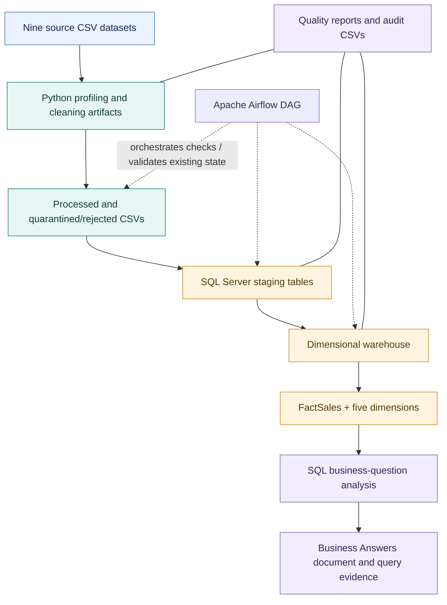

from pathlib import Path

readme = r'''<div align="center">

# NexusMart Data Analytics & Engineering Pipeline

### CodeConnect’26 · Module 02 — Data Analytics Challenge

**From raw retail data to a validated SQL Server warehouse, orchestrated workflow, and business-focused analysis.**

[](https://www.python.org/)
[](https://www.microsoft.com/sql-server)
[](https://airflow.apache.org/)
[](https://powerbi.microsoft.com/)

**Individual project · Built by [Aaisha Iqbal](https://github.com/Aaisha-Nexus)**

</div>

---

## Table of Contents

- [Project Overview](#project-overview)
- [Project Objectives](#project-objectives)
- [Architecture](#architecture)
- [Technology Stack](#technology-stack)
- [Repository Structure](#repository-structure)
- [Data Sources and Cleaning](#data-sources-and-cleaning)
- [Data Warehouse Design](#data-warehouse-design)
- [Airflow Orchestration](#airflow-orchestration)
- [Business Analysis](#business-analysis)
- [Documentation and Evidence](#documentation-and-evidence)
- [Running and Inspecting the Project](#running-and-inspecting-the-project)
- [Challenges and Engineering Learnings](#challenges-and-engineering-learnings)
- [Known Limitations](#known-limitations)
- [Future Improvements](#future-improvements)
- [Project Status](#project-status)
- [Author](#author)

---

## Project Overview

NexusMart is a retail analytics case study developed for **CodeConnect’26 — Module 02: Data Analytics**. The project works with nine related CSV datasets covering customers, locations, orders, order items, payments, products, returns, sellers, and shipping.

The objective was to build and document a practical analytics workflow that moves beyond one-off queries: profile the source data, clean and validate records, load a SQL Server warehouse, model the data for analysis, orchestrate key workflow checks with Apache Airflow, and use SQL to investigate the challenge's 15 business questions.

The work includes Python-based profiling and cleaning artifacts, staging tables, a dimensional warehouse model, SQL analysis scripts, a local Airflow DAG, and supporting evidence and documentation. Power BI model and DAX work was also started; **a completed interactive Power BI dashboard is not part of the current submission**.

> **Scope note:** This repository reflects the implementation reached during the hackathon. Some stages are demonstrated through existing processed outputs and validation tasks rather than a fully reproducible raw-to-warehouse rebuild. Known limitations are documented explicitly rather than presented as resolved.

## Project Objectives

- Profile the supplied datasets and identify quality issues before analysis.
- Preserve traceability for duplicate, invalid, missing, or unresolved records.
- Apply the challenge's business rules consistently, including PKR amounts, discount handling, returns, cancellations, shipping fees, and date interpretation.
- Build a SQL Server staging layer and dimensional model suitable for retail analysis.
- Define and validate fact-table grain, dimension keys, and key financial measures.
- Use Apache Airflow to organize and execute workflow validation tasks.
- Answer the 15 official business questions using SQL and document the evidence and caveats.
- Record implementation challenges, decisions, limitations, and future improvements.

## Architecture

The diagram below represents the **current implemented workflow at a high level**. It intentionally does not show Power BI as a completed reporting stage.



### Workflow summary

1. **Source profiling:** inspect each CSV's row counts, columns, types, duplicates, and quality issues.
2. **Cleaning and exception handling:** produce processed data and retain rejected/quarantined records with supporting quality artifacts.
3. **Staging:** load the processed datasets into SQL Server staging tables.
4. **Warehouse modelling:** use a line-level fact table and conformed dimensions for analytical queries.
5. **Orchestration:** use a local Airflow DAG to organize validation and checks across the workflow.
6. **Analysis and evidence:** execute SQL queries for the official business questions and retain results, documentation, and schema evidence.

**Important distinction:** the current Airflow DAG successfully ran its seven configured tasks, but several tasks validate existing processed files or populated warehouse tables rather than rebuilding every stage from raw data. See [Airflow Orchestration](#airflow-orchestration) and [Known Limitations](#known-limitations).

## Technology Stack

| Area | Tools | Role in the project |
|---|---|---|
| Data preparation | Python, pandas, notebooks | Profiling, cleaning, validation, and exception reporting |
| Source format | CSV | Supplied retail datasets and processed outputs |
| Database | Microsoft SQL Server | Staging tables, dimensional tables, fact table, and analytical SQL |
| Data modelling | Star schema | Organizes order-line facts around shared dimensions |
| Orchestration | Apache Airflow, Astro CLI, Docker Desktop | Runs the local DAG and its validation workflow |
| Analytics | SQL | Business metrics, comparisons, trends, and question-based analysis |
| Semantic modelling | Power BI, DAX | Initial model and measure development; dashboard remains future work |
| Version control | Git, GitHub | Source control and submission repository |
| Documentation | Markdown, Word, screenshots | Business answers, implementation notes, and execution evidence |

## Repository Structure

The repository is organized around code, SQL, reports, documentation, and screenshots. The tree below is a **guide to the main folders**, not a guarantee that every optional file listed in a generic project template exists.

```text
CodeConnect26_DataAnalytics/
├── airflow/                         # Local Airflow/Astro-related project files, if included
├── dags/                            # Submitted DAG source
├── data/                            # Source and/or processed datasets, subject to repository contents
├── important documentations/
│   ├── Business Answers.docx
│   ├── CodeConnect26_NexusMart_Challenges_Learnings_Limitations.docx
│   └── NexusMart_DAX_Measures.docx
├── logs/                            # Local execution logs; inspect before publishing
├── notebooks/                       # Profiling and cleaning notebooks
├── powerbi/                         # Power BI-related files, if present
├── reports/
│   ├── Star_Schema_Diagram.png       # Schema evidence may also be under screenshots/
│   └── ...                          # Data-quality reports and audit outputs
├── screenshots/
│   ├── airflow/                     # Airflow UI / DAG execution evidence
│   └── star schema/                 # Star schema screenshot
├── sql/                             # Staging, dimensions, fact loading, and validation scripts
├── src/                             # Python profiling, cleaning, and loading utilities
├── .gitignore
└── README.md
```

### Important files and folders

- **`dags/`** — DAG source included for review and submission.
- **`sql/`** — SQL scripts for staging, dimensions, FactSales, date dimension, relationships, and quality checks.
- **`src/`** — Python utilities related to profiling, cleaning finalization, and data loading.
- **`notebooks/`** — exploratory profiling and cleaning work.
- **`reports/`** — quality summaries, reconciliation reports, exception/audit outputs, and other supporting artifacts.
- **`screenshots/airflow/`** — evidence of the local Airflow environment and successful DAG run.
- **`screenshots/star schema/`** — visual evidence of the dimensional model.
- **`important documentations/`** — the business-question answers, engineering challenges/limitations, and DAX implementation notes.

> Before publishing, review `data/`, `logs/`, and row-level audit CSVs. Include only files permitted by the challenge and useful to reviewers; never commit credentials, `.env` files, or local secrets.

## Data Sources and Cleaning

The challenge supplied nine datasets:

| Dataset | Analytical role |
|---|---|
| Customers | Customer attributes and registration information |
| Locations | Geographic attributes used for location analysis |
| Orders | Order-level dates, statuses, channels, and order information |
| OrderItems | Line-level products, quantities, and item values |
| Payments | Payment-method information and payment records |
| Products | Product, category, and cost/price attributes |
| Returns | Return statuses, reasons, and refund information |
| Sellers | Seller attributes and seller-tier analysis |
| Shipping | Courier, shipping-fee, shipment, and delivery-date information |

The cleaning work focused on more than removing duplicates. It included profiling, type and date checks, missing and negative value review, duplicate analysis, reference validation, and retained-versus-quarantined record accounting.

### Recorded data-quality findings

The project notes record the following results from the cleaning and validation work:

- Nine source datasets were profiled.
- **7,118 unique quarantined rows** were reported in the recorded cleaning notes.
- Processed outputs were reported to have zero remaining exact duplicates and duplicate primary keys after the applied cleaning.
- **1,381 truly broken references** and **7,937 references to quarantined parents** were identified in the recorded audit notes, with **9,318 row-level exceptions** reported.
- **1,731** invalid or ambiguous customer registration dates were flagged.
- **988** negative values were flagged for review.

These are recorded findings from the current project artifacts. Consult the reports and exception files for the precise definitions and row-level evidence behind each figure.

### Selected row reconciliation

| Dataset | Source rows | Retained | Quarantined | Duplicate copies |
|---|---:|---:|---:|---:|
| Customers | 45,000 | 45,000 | 0 | 0 |
| Locations | 650 | 650 | 0 | 0 |
| Orders | 163,200 | 158,250 | 1,750 | 3,200 |
| OrderItems | 315,143 | 313,250 | 1,893 | 0 |
| Payments | 168,111 | 163,586 | 1,229 | 3,296 |
| Products | 3,200 | 3,200 | 0 | 0 |
| Returns | 16,048 | 15,912 | 136 | 0 |
| Sellers | 420 | 416 | 4 | 0 |
| Shipping | 151,228 | 149,122 | 2,106 | 0 |

The counts above should be read alongside the cleaning reports. Quarantined rows, duplicate copies, and retained rows describe different outcomes and should not be added together without considering how the reconciliation was defined.

### Business rules considered

The analysis and warehouse work considered the challenge's specified rules, including:

- Monetary values are in **PKR**.
- `order_total` represents merchandise value after discounts.
- A blank discount code means no discount.
- Shipping is paid by NexusMart; the shipping fee should be allocated once per order rather than duplicated on every order line.
- Returns marked `Rejected` are not valid returns for refund calculations.
- Slash-formatted dates are intended to be interpreted as day/month/year, subject to validation.
- The allowed order-date window is 1 January 2024 through 30 June 2025.
- Orders in `In Transit` status that are not cancelled still count toward NMV.
- Valid refunds, delivered lines, kept lines, cancellation rates, and margin must follow their respective definitions in the challenge brief.

## Data Warehouse Design

The SQL Server warehouse uses a star-schema approach with **FactSales** at order-line grain and five dimensions.

### Star schema


If the image does not render in the GitHub preview, open it directly from the [`screenshots/star schema`](screenshots/star%20schema/) folder.

### Tables and grain

| Table | Role |
|---|---|
| `dw.FactSales` | Central fact table, intended to contain one row per retained order item |
| `dw.DimDate` | Calendar attributes, month/year fields, and event/holiday labels |
| `dw.DimCustomer` | Customer attributes; Type 1 handling is the minimum stated approach |
| `dw.DimProduct` | Product, category, subcategory, brand, and price/cost attributes |
| `dw.DimSeller` | Seller identity and seller attributes |
| `dw.DimLocation` | City, province, region, and other geographic attributes |

Dimensions filter the fact table; they are not intended to form a chain of dimension-to-dimension relationships.

### Recorded warehouse checks

- `FactSales` contained **309,785 rows** and **309,785 distinct `OrderItemID` values** in the recorded validation.
- The five dimensions and `FactSales` were loaded into the Power BI model during initial semantic modelling.
- The date dimension covered **547 days**, from 1 January 2024 to 30 June 2025.
- The calendar validation recorded **75 event days** across Ramadan, Eid-ul-Fitr, Eid-ul-Adha, Independence Day, Singles Day, and Black Friday.
- Unknown dimension members were used to retain traceability for unresolved source references.

### Reconciliation items

The warehouse is useful for analysis, but it is not free of unresolved data-quality issues:

- **3,465 retained processed order items** were absent from FactSales because their order relationship could not be resolved in the load.
- Recorded source shipping fees totalled approximately **PKR 76.04 million**, while allocated shipping fees in FactSales totalled approximately **PKR 75.02 million**.
- Unknown product references appeared in category analysis and should not be silently assigned to a known category.

These differences are documented limitations and should be reconciled before treating all warehouse totals as fully complete.

## Airflow Orchestration

A local Airflow environment was set up using **Astro CLI and Docker Desktop**, with a SQL Server connection to the `NexusMartDW` database.

### DAG tasks

The observed successful DAG run included seven tasks:

1. `extract`
2. `validate_raw`
3. `clean`
4. `load_staging`
5. `build_dimensions`
6. `build_fact`
7. `quality_checks`

### Execution evidence

The screenshots below are retained as evidence of the local Airflow setup and successful task run.


Additional screenshots are available in [`screenshots/airflow/`](screenshots/airflow/).

### Important implementation detail

The current DAG is an **orchestration and validation prototype**, not yet a fully reproducible production ETL pipeline. The observed run completed successfully, but several tasks verify existing processed files or populated warehouse tables instead of rebuilding the complete pipeline from raw CSVs. This distinction matters: a successful run proves the configured tasks completed, not that all raw-to-warehouse transformations can be recreated from a clean state.

## Business Analysis

SQL queries were developed for the 15 official business questions in the challenge. The answers and supporting evidence are documented separately.

### Question areas

| Area | Questions explored |
|---|---|
| Core performance | Revenue and margin by category |
| Geography | Province/city contribution and top-city share |
| Revenue trends | Monthly NMV/net revenue and month-over-month change |
| Returns and cancellations | Overall rates and movement over time |
| Profitability | Gross sales, discounts, refunds, net revenue, and margin |
| Customer value | Observed customer value and repeat purchasing |
| Customer segmentation | RFM segments and their reported contribution |
| Seller performance | Revenue, return rate, cancellation rate, and provisional scoring |
| Delivery performance | Delivery duration, returns, cancellations, and regional differences |
| Product quality | Product–seller combinations with elevated return rates |
| Seasonality | Ramadan, Eid, Singles Day, Black Friday, and Independence Day |
| Discounts | Discounted versus non-discounted performance |
| Payment methods | Differences in observed cancellation and return rates |
| Overall profitability | Possible drivers and recommended business actions |

### Metric discipline

The analysis uses the challenge's definitions as the intended basis for comparison. Key distinctions include:

- **Gross sales:** quantity multiplied by unit price before discounts and cancellations.
- **NMV:** merchandise value after discounts for non-cancelled lines.
- **Net revenue:** NMV minus refunds from valid, non-rejected returns.
- **AOV:** NMV divided by the number of non-cancelled orders.
- **Return rate:** valid-return lines divided by delivered lines.
- **Cancellation rate:** cancelled orders divided by all orders after duplicate removal.
- **Margin:** net revenue minus cost of goods on kept lines.
- **Kept lines:** non-cancelled lines without a valid return.

The business-answer document contains the current interpretations and limitations. Some outputs remain provisional and should be rechecked before they are used as final business claims—particularly RFM revenue reconciliation, payment-method denominators, and delivery-date coverage.

## Documentation and Evidence

The repository contains separate documentation for business results, implementation challenges, and DAX work.

- [Business Answers](important%20documentations/Business%20Answers.docx) — current written responses to the 15 business questions and associated findings.
- [Challenges, Learnings & Limitations](important%20documentations/CodeConnect26_NexusMart_Challenges_Learnings_Limitations.docx) — engineering challenges and decisions across cleaning, SQL modelling, Airflow, analysis, reproducibility, and next steps.
- [DAX Measures](important%20documentations/NexusMart_DAX_Measures.docx) — screenshots of the DAX measures started during Power BI semantic-model development.
- [Airflow screenshots](screenshots/airflow/) — local environment and execution evidence.
- [Star schema screenshot](screenshots/star%20schema/Star_Schema_Diagram.png) — visual evidence of the warehouse model.
- `reports/` — data-quality reports, reconciliation outputs, and audit CSVs.
- `sql/` — SQL scripts for staging, dimension/fact setup, population, date dimension completion, relationships, and validation.
- `notebooks/` and `src/` — profiling, cleaning, and data preparation work.

> **Documentation status:** screenshots and documents are evidence of work performed, but they do not replace the underlying scripts. Where a process is not fully reproducible from raw data, that limitation is stated.

## Running and Inspecting the Project

This repository contains a local SQL Server and Airflow implementation. The exact connection name, credentials, and runtime settings depend on the local machine; do not publish real passwords or secret connection details.

### Prerequisites

- Python environment suitable for the scripts and notebooks in `src/` and `notebooks/`
- Microsoft SQL Server and SQL Server Management Studio (SSMS)
- Docker Desktop
- Astro CLI / Apache Airflow
- Git
- Power BI Desktop is only needed to inspect the semantic model and DAX work, not to run the SQL or Airflow checks

### Suggested inspection order

1. Review the [Challenges, Learnings & Limitations](important%20documentations/CodeConnect26_NexusMart_Challenges_Learnings_Limitations.docx) document for scope and known constraints.
2. Inspect the profiling and cleaning notebooks in `notebooks/`, relevant scripts in `src/`, and quality artifacts in `reports/`.
3. Review the SQL scripts in `sql/` in their intended order. **Do not blindly rerun create/populate scripts against an already populated database**; inspect their contents and current database state first.
4. Review the star schema image and the SQL validation scripts.
5. Inspect the DAG source under `dags/` and the Airflow screenshots. The local Airflow environment must have its own valid connection configuration and dependencies.
6. Review the business-answer document alongside the SQL queries that support each finding.
7. Open the DAX document if you want to inspect the initial Power BI measures.

### Database and credentials

The local environment used SQL Server and the `NexusMartDW` database. The Airflow connection was tested successfully in the development environment. **No password or secret is documented here.** Configure credentials through the local Airflow connection or a secure environment-specific method.

## Challenges and Engineering Learnings

| Challenge | What it taught us |
|---|---|
| Different source-table grains | Identify the grain and keys before joining, or totals can multiply. |
| Duplicate rows versus similar entities | Exact duplicates and possible duplicate people/businesses require different rules. |
| Broken and quarantined references | Unknown dimension members preserve traceability but do not repair source data. |
| Date parsing and numeric validation | A parseable value is not automatically a valid business value. |
| Order-level shipping fees and line-level facts | Allocation must be explicit and reconciled at the correct grain. |
| Missing or unreliable shipping dates | Do not infer on-time performance from invalid or zero-filled duration fields. |
| Small denominators in product return rates | Report numerator and denominator; prioritize high-volume issues for investigation. |
| Payment method and event comparisons | Descriptive associations do not prove causation; category labels and exposure can differ. |
| Airflow tasks validating existing state | A green DAG run is not the same as a complete, idempotent raw-to-warehouse rebuild. |
| Separate local and repository folders | Verify that implementation files—not just screenshots—are included in the submitted repository. |

The detailed discussion and current evidence are in the [Challenges, Learnings & Limitations document](important%20documentations/CodeConnect26_NexusMart_Challenges_Learnings_Limitations.docx).

## Known Limitations

The current implementation has the following known constraints:

1. **Raw-to-clean reproducibility:** the recorded finalization workflow consumes processed/rejected outputs; not every historical cleaning transformation is rebuilt by one deterministic script from the raw CSVs.
2. **Unmatched order items:** 3,465 retained order items did not reach FactSales because their order references could not be resolved in the load.
3. **Shipping-fee reconciliation:** source and allocated fact shipping-fee totals differ by approximately PKR 1.02 million.
4. **Unknown dimension references:** unknown product and other unknown members remain in the warehouse and can affect category/geographic results.
5. **Delivery data quality:** `ShippingDays` was unreliable; only 848 of 278,863 eligible fact rows had populated values, and all populated values were zero in the recorded validation. Source-date parsing and coverage also remain problematic.
6. **On-time delivery:** the source schema inspected included shipped and delivered dates but did not show a promised-delivery date. Delivery duration cannot therefore establish whether an order met a commitment.
7. **Provisional analyses:** the RFM segment totals need reconciliation with the overall customer-value result. Payment-method and delivery findings require careful interpretation of denominators and missing data.
8. **Airflow scope:** the current DAG validates much of the existing processed and warehouse state rather than rebuilding the entire raw-to-fact pipeline from scratch.
9. **Power BI dashboard:** the semantic model and DAX work were started, but a complete interactive dashboard was not finished for the current submission.

These limitations are part of the project record and should be addressed before using the outputs for operational or financial decisions.

## Future Improvements

The following are planned improvements, not claims about completed functionality:

- Make the full raw-to-clean pipeline deterministic and rerunnable from the original source files.
- Add automated reconciliation for input, retained, rejected, and loaded rows at each stage.
- Resolve and document orphan references and shipping-fee allocation differences.
- Improve date parsing with explicit formats, raw-value diagnostics, and automated tests.
- Add a true idempotent Airflow workflow that rebuilds or incrementally refreshes each layer from source data.
- Reconcile RFM revenue totals and validate every KPI against the official business definitions.
- Develop a complete Power BI report with executive KPIs, trend analysis, product/category performance, geography, customer segments, seller performance, and returns/cancellations.
- Add report slicers and drill-through interactions only after measures have been reconciled against SQL.
- Add automated tests for fact grain, dimension keys, financial totals, rejected-return handling, and calendar coverage.

## Project Status

| Component | Status |
|---|---|
| Source profiling and cleaning artifacts | Completed to the extent documented in the notebooks, scripts, and reports |
| SQL Server staging and dimensional warehouse | Implemented; reconciliation issues remain |
| Star schema and date dimension | Implemented and supported by schema evidence |
| SQL business-question analysis | Queries and written answers prepared; selected metrics need further reconciliation |
| Airflow local DAG | Seven-task run completed; workflow is primarily a validation/orchestration prototype |
| Power BI semantic model and DAX | Started; formulas and screenshots documented |
| Interactive Power BI dashboard | **Not completed in the current submission** |
| README and technical documentation | Being consolidated for submission |

## Author

**Aaisha Iqbal**  
Computer Science student · University of Karachi (UBIT)

- GitHub: [@Aaisha-Nexus](https://github.com/Aaisha-Nexus)
- Project repository: [CodeConnect26 Data Analytics Datathon](https://github.com/Aaisha-Nexus/CodeConnect26-DataAnalytics-Datathon)

---

<div align="center">

**Built as an individual CodeConnect’26 project.**

*The goal was not only to produce analytical outputs, but also to document the decisions, data-quality constraints, and engineering work required to make those outputs interpretable.*

</div>
'''
path = "/mnt/data/README_NexusMart_CodeConnect26.md"
Path(path).write_text(readme, encoding="utf-8")
print(f"Created {path} ({len(readme.splitlines())} lines, {len(readme):,} characters)")
